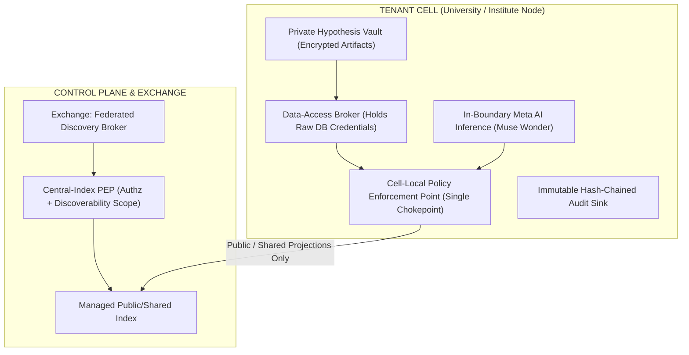

# Nexus — The Living Campus Graph & Autonomous Grant Studio

> **Connecting Minds. Synthesizing Science.**  
> Pre-publication campus discovery, zero-knowledge hypothesis protection, and verified scientific grant synthesis.

[](https://opensource.org/licenses/Apache-2.0)
[](https://www.python.org/)
[](https://nextjs.org/)
[](https://ai.meta.com/)

---

## 1. System Overview & Vision

University campuses are filled with brilliant research happening in isolation: an undergrad building a novel neural signal decoder in their dorm, a postdoc in robotics needing biological telemetry, and a professor looking for interdisciplinary co-PIs on a $1.2M federal grant. Traditional academic tools only see published papers years after work began.

**Nexus** bridges this invisible wall:
1. **The Living Campus Graph:** Ingests student code, pre-prints, lab facilities, and faculty profiles into a dynamic, queryable property graph.
2. **Double Opt-In Serendipity Matching:** Bilateral compatibility scoring that sparks collaborations across departments while protecting pre-publication ideas.
3. **Private Hypothesis Vault:** Cryptographic Proof of Priority with SHA-256 + Merkle root anchors (`NX-####` certificates) ensuring researchers can safely prove priority before disclosing ideas.
4. **Autonomous Grant Studio:** Leverages Meta AI frontier reasoning (`muse-wonder-1.0`) to synthesize fully-grounded NSF, NIH, and DARPA proposals with citation audit trails verified against source literature.

---

## 2. Core Architecture & Security Invariants

Nexus implements the federated enterprise architecture specified in [`plans/final-plan-v2.md`]:



### Invariants:
- **Single Confidentiality Chokepoint (D4):** Every data retrieval, egress projection, and derivation in a cell flows through one Policy Enforcement Point (`IPolicyEnforcement`) and Data-Access Broker. Feature modules never see raw database credentials.
- **3-Tier Classification Lattice (D5/D6):** `PUBLIC < SHARED < CONFIDENTIAL`. Combining resources computed with the MAX-rule: `max(tier_a, tier_b)`. Confidential artifacts are strictly forbidden from entering publishable projections.
- **Fail-Closed Revocation Authority:** The owning university node is the sole local authority. Revocations are immediately enforced on drill-downs.

---

## 3. Monorepo Workspace Structure

```
nexus/
├── pyproject.toml                         # Root workspace configuration
├── README.md                              # System architecture & documentation
├── packages/
│   ├── contracts/                         # nexus-contracts
│   │   ├── pyproject.toml
│   │   └── src/nexus_contracts/
│   │       ├── lattice.py                 # Tier (PUBLIC < SHARED < CONFIDENTIAL), MAX-rule algebra
│   │       ├── projection.py              # PublishableProjection, DiscoverabilityScope, schema versioning
│   │       ├── models.py                  # Principal, PolicyVerdict, AccessGrant, GroundingSource, GrantProposal
│   │       └── interfaces.py              # Canonical ABCs (IPolicyEnforcement, IModelRouter, IGrantStore, etc.)
│   ├── enforcement/                       # nexus-enforcement
│   │   ├── pyproject.toml
│   │   └── src/nexus_enforcement/
│   │       ├── pep.py                     # Single Policy Enforcement Point (PEP) chokepoint
│   │       └── broker.py                  # Data-Access Broker with per-module DB isolation
│   ├── discovery/                         # nexus-discovery
│   │   ├── pyproject.toml
│   │   └── src/nexus_discovery/
│   │       ├── campus_graph.py            # Living Campus Graph with interdisciplinary gap analysis
│   │       └── matcher.py                 # Double opt-in bilateral collaborator matcher
│   ├── intelligence/                      # nexus-intelligence
│   │   ├── pyproject.toml
│   │   └── src/nexus_intelligence/
│   │       ├── meta_client.py             # Native Meta Muse Wonder 1.0 & Spark 1.3 client (reasoning tokens)
│   │       ├── citation_auditor.py        # Claim-to-source evidence verification
│   │       └── synthesizer.py             # Autonomous Specific Aims & Technical Narrative drafting
│   ├── workspace/                         # nexus-workspace
│   │   ├── pyproject.toml
│   │   └── src/nexus_workspace/
│   │       ├── priority_proof.py          # Cryptographic SHA-256 + Merkle root priority proofs
│   │       └── vault.py                   # Zero-knowledge idea sealing before mutual disclosure
│   └── funding/                           # nexus-funding
│       ├── pyproject.toml
│       └── src/nexus_funding/
│           ├── finder.py                  # Federal opportunity finder (NSF SCC, NIH R21, DARPA YFA)
│           └── tracker.py                 # 5-stage milestone Pursuit Tracker (Flightpath)
├── services/
│   └── api/                               # nexus-api (FastAPI backend service)
│       ├── pyproject.toml
│       └── src/nexus_api/
│           ├── main.py                    # App entrypoint with CORS, health check & routers
│           └── routes/                    # /vault, /discovery, /funding, /intelligence
├── frontend/                              # nexus-frontend (Next.js 16 Turbopack)
│   ├── package.json
│   ├── src/app/page.tsx                   # Figma-audited production collaboration studio
│   └── src/app/globals.css                # Polished design system styles
└── tests/                                 # Unit & platform test suite
    ├── test_lattice.py
    ├── test_pep_and_vault.py
    └── test_full_platform.py
```

---

## 4. Getting Started

### Prerequisites
- Python 3.12+
- Node.js 20+ & npm
- Meta AI API Key (optional, defaults to deterministic fixture mode if unset)

### Backend Setup
```bash
# Clone the repository
git clone https://github.com/nexus-research-ai/nexus.git
cd nexus

# Create and activate virtual environment
python3 -m venv .venv
source .venv/bin/activate

# Install workspace in editable mode
pip install -e packages/contracts -e packages/enforcement -e packages/discovery -e packages/intelligence -e packages/workspace -e packages/funding -e services/api

# Run test suite
pytest tests/ -v
```

### Frontend Setup
```bash
cd frontend
npm ci
npm run build
npm run dev
```

Open `http://localhost:3000` to interact with the Nexus Living Campus Graph, Private Vault, and Proposal Studio.

---

## 5. Security & Privacy

Nexus is designed from the ground up for strict pre-publication data confidentiality:
- All communications are authenticated through institutional sessions.
- Private hypotheses in the Vault are hashed client-side before priority certificates are anchored.
- Mutual disclosure is strictly bilateral; no private project details or researcher identities are revealed until both parties confirm mutual interest.

---

## 6. License

Apache License 2.0. See [LICENSE](LICENSE) for details.
